# Fulfilment — Ръководство

## Част 1 — Ежедневна работа

### 1. Какво прави Fulfilment

Fulfilment проверява поръчките от Shopify за деня спрямо наличностите в склада. Показва кои поръчки могат да се изпратят изцяло. След това прави списъците за опаковане и експортите на наличности за клиента.

Packing Tool опакова списъците за опаковане, които Fulfilment е направил. Стъпките са:

1. Вземете експорта на поръчките от Shopify. Той е CSV файл.
2. Вземете експорта на наличностите в склада. Той е CSV файл.
3. Заредете двата файла във Fulfilment и стартирайте анализа.
4. Проверете резултатите и направете списъците за опаковане.
5. Packing Tool отваря списъците за опаковане.

### 2. Стартиране на приложението

1. Отворете **Fulfilment Tool**.
2. Погледнете долната част на лявата странична лента. **Свързан със сървъра** означава, че този компютър може да достигне сървъра. Ако пише **Няма връзка със сървъра**, вижте раздел 11.
3. За да смените езика, натиснете **EN** или **BG** в долната част на страничната лента. За да смените темата, натиснете **Светла** или **Тъмна**.
4. Натиснете ⋯ горе вдясно. Менюто съдържа **Ръководство**, **Връзка със сървъра…**, **Провери за актуализации…** и **Клавишни комбинации…**.

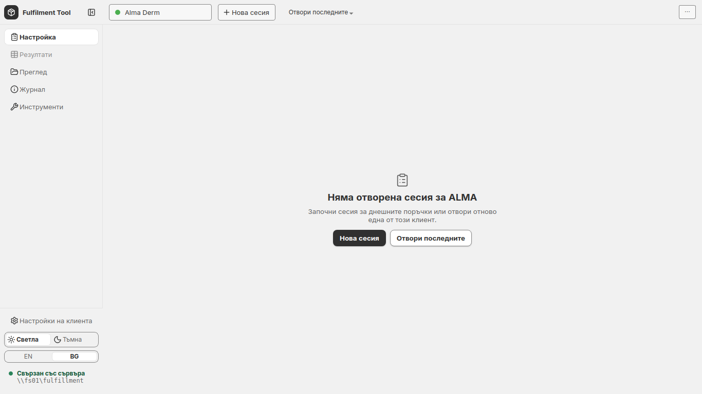

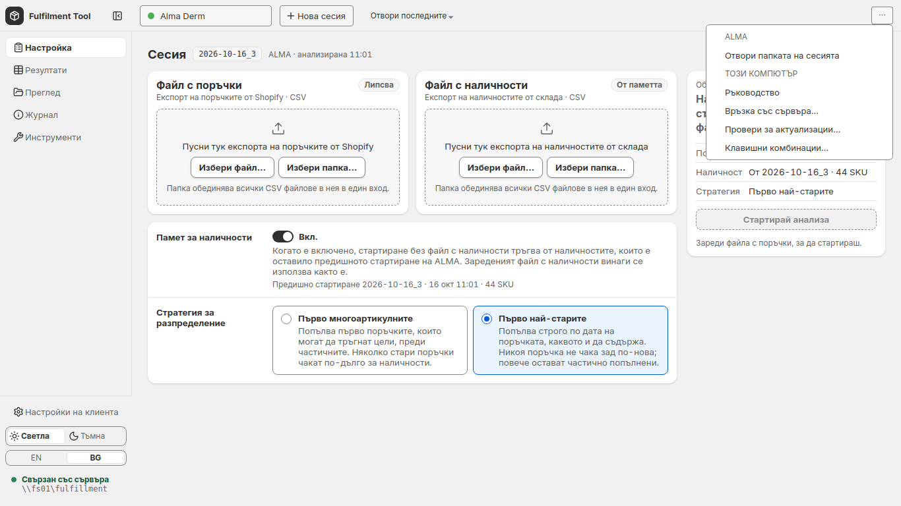

### 3. Избор на клиент

Всяка сесия, файл с наличности и отчет принадлежи на един клиент.

1. Натиснете името на клиента горе вляво.
2. За да намерите клиент, въведете в **Филтрирай клиентите**.
3. Натиснете клиента, от който се нуждаете.

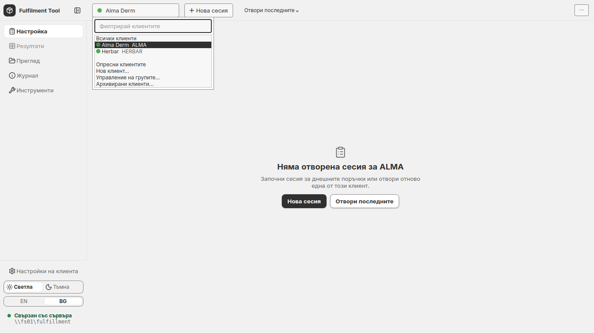

### 4. Започнете сесия и заредете файловете

Сесията съдържа поръчките за един ден за един клиент.

1. Натиснете **Нова сесия**. Новата сесия има в името си днешната дата, например `2026-10-16_4`.
2. В **Файл с поръчки** пуснете експорта на поръчките от Shopify в полето. Можете и да натиснете **Избери файл…**. За да слеете няколко CSV файла в един вход, натиснете **Избери папка…**.
3. В **Файл с наличности** направете същото с експорта на наличностите в склада. Оставете полето празно, ако искате наличностите от последното стартиране. Когато **Памет за наличности** е **Вкл.**, стартиране без файл с наличности започва от наличностите, останали след последното стартиране. Файл с наличности, който сте заредили, винаги се използва такъв, какъвто е.
4. Изберете **Стратегия за разпределение**:
   - **Първо най-старите** разпределя строго по дата на поръчката. Никоя поръчка не чака зад по-нова. Някои поръчки може да бъдат изпълнени частично.
   - **Първо многоартикулните** изпълнява първо поръчките, които могат да излязат цели, и после частичните. Някои стари поръчки може да чакат по-дълго за наличности.

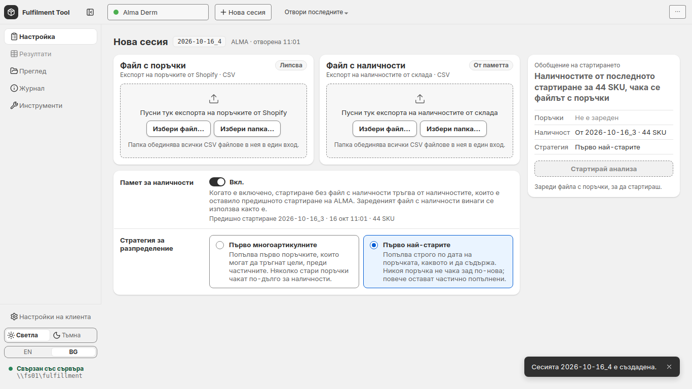

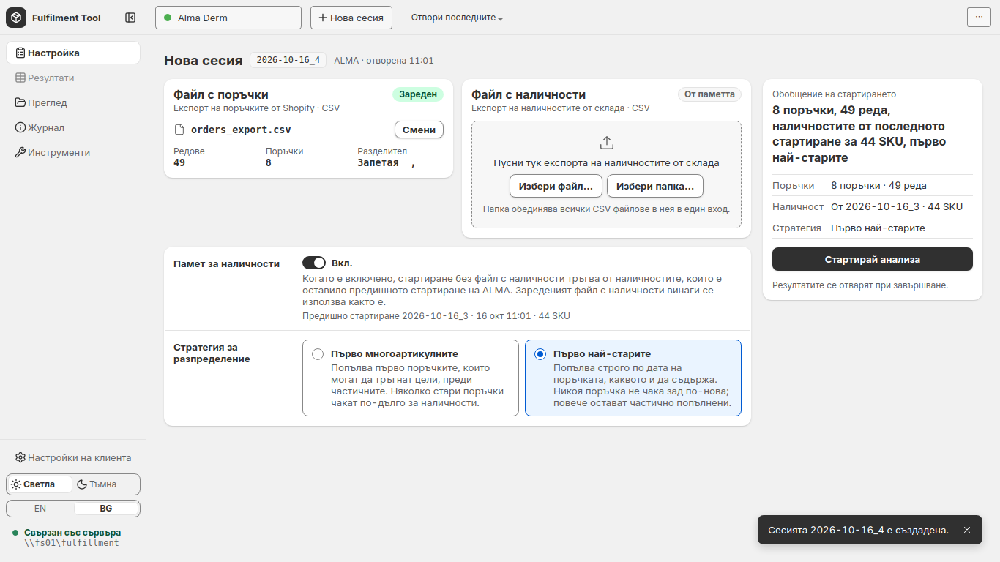

> **Съвет:** **Стартирай анализа** остава сиво, докато не се зареди файлът с поръчки.

### 5. Стартиране на анализа

1. Проверете картата **Обобщение на стартирането** вдясно. Тя показва поръчките и редовете, наличностите, които са използвани, и стратегията.
2. Натиснете **Стартирай анализа**. Можете и да натиснете **Ctrl+R**.
3. Изчакайте. Страницата Настройка показва стъпката, на която е стартирането. Когато то приключи, се отваря разделът **Резултати**.

### 6. Прочетете резултатите

Натиснете **Резултати** в страничната лента. Таблицата има по един ред за всяка поръчка.

- **Изпълнима** означава, че цялата поръчка може да излезе. **Блокирана** означава, че поне един ред с SKU е с недостиг, така че цялата поръчка чака.
- Числата горе са **Поръчки**, **Изпълнима**, **Блокирана**, **Етикети** и **Готова стойност**. **Етикети** е по един куриерски етикет за всяка изпълнима поръчка, разделен по куриер.
- За да намерите поръчка, въведете в полето за търсене **Поръчка, клиент или SKU**.
- За да стесните списъка, натиснете **Добави филтър**. Можете да филтрирате по **Статус**, по **Флагове**, по **Куриер** или по **Тагове**. Флаговете са **Повтаряща се**, **Непознат SKU**, **Ниска наличност** и **3 или повече реда**.
- За да изберете и подредите колоните, натиснете **Колони**. **Статус** и **Поръчка** винаги остават първи.
- Натиснете ред. Панелът **Детайл на поръчката** вдясно показва дали поръчката може да излезе и, ако не може, защо.
- За да задържите изпълнима поръчка, натиснете **Задръж** в панела с детайлите. За да маркирате блокирана поръчка като изпълнима, натиснете **Маркирай като изпълнима**.
- Маркирайте квадратчетата в началото на няколко реда, за да действате върху тези поръчки заедно.
- За да направите списъците за опаковане и експортите на наличности, натиснете **Експорт**. Вижте раздел 7.

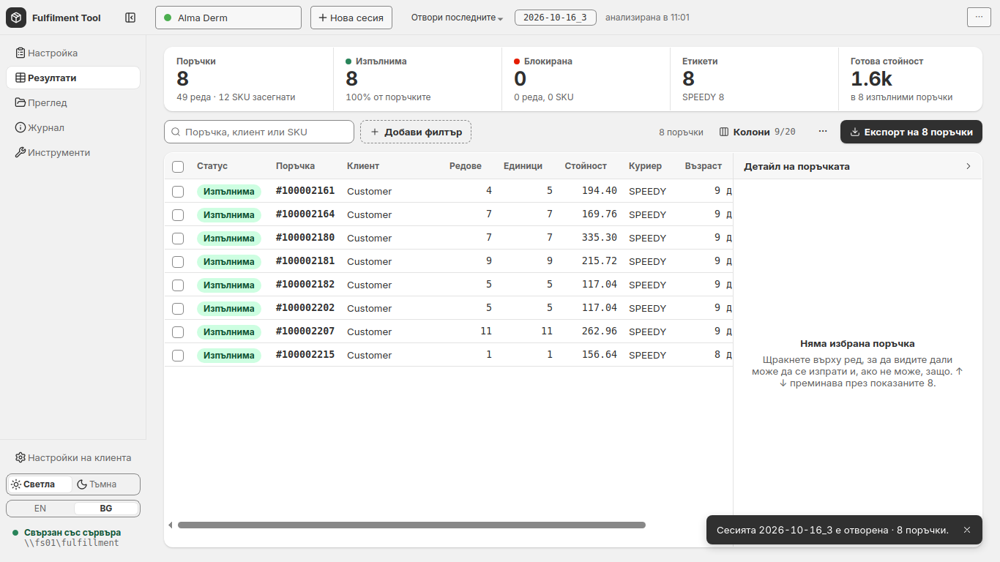

> **Забележка:** Повтаряща се поръчка се маркира, но никога не се задържа. Тя остава изпълнима.

> **Забележка:** Текстът в панела с детайли казва кой е задал статуса. Той гласи или **Открито от изпълнението, не е зададено от човек.**, или **Зададено от човек, не открито от изпълнението.**

За да добавите артикул към поръчка:

1. Натиснете ⋯ горе в раздел **Резултати**, после натиснете **Добави артикул към поръчка**.
2. Въведете номера на поръчката в **Номер на поръчка:**.
3. Въведете SKU в **SKU на артикул:**. Променете **Количество:**, ако са ви нужни повече от един.
4. Натиснете **Добави артикул**.

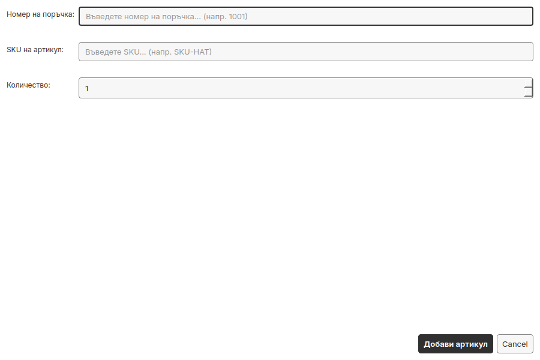

### 7. Направете списъците за опаковане и експортите на наличности

1. В раздела **Резултати** натиснете **Експорт**. Отваря се прозорецът **Генерирай отчети**.
2. Маркирайте всеки списък за опаковане под **СПИСЪЦИ ЗА ОПАКОВАНЕ**. Маркирайте всеки експорт на наличности под **ЕКСПОРТИ НА НАЛИЧНОСТИ**. Прегледът показва колко поръчки и реда съвпадат.
3. Под **Отписване на опаковки** изберете една опция: **Не включвай опаковъчните материали**, **Включи ги в експорта на наличности** или **Запиши ги в отделен файл**.
4. Натиснете **Генерирай избраните отчети**.

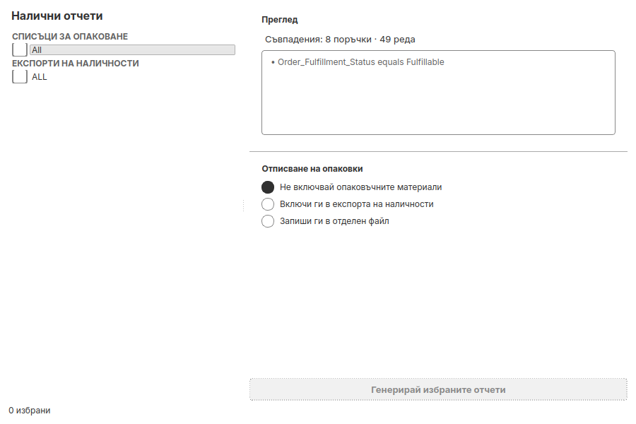

Списъците за опаковане се записват в папката `packing_lists` на сесията. Експортите на наличности се записват в папката `stock_exports`. Packing Tool чете списъците за опаковане от тази папка.

> **Забележка:** Ако поръчките се променят, след като е направен списък за опаковане, направете списъка отново. Новият списък заменя стария.

### 8. Отваряне на по-стара сесия в Преглед

1. Натиснете **Преглед** в страничната лента.
2. Натиснете раздел, за да филтрирате сесиите: **Всички**, **Активна**, **Завършена**, **Изоставена** или **Архивиран**.
3. За да намерите сесия по името или коментара ѝ, въведете в **Търсене на сесии**.
4. Щракнете два пъти върху сесията, за да я отворите.

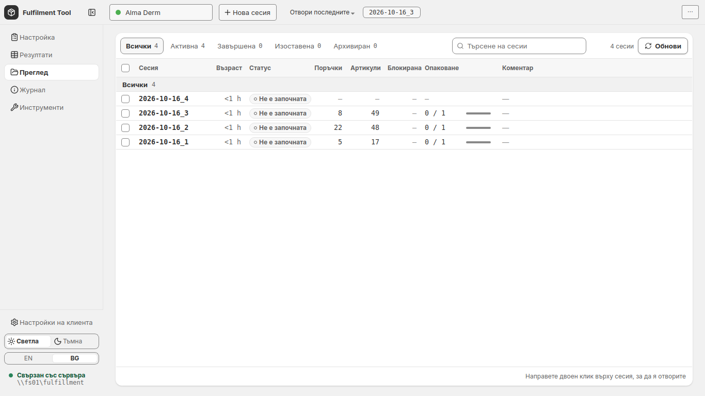

Колоната **Статус** показва **Не е започната**, **В ход**, **Паузирана**, **Застояла**, **Завършена**, **Незавършена** или **Изоставена**. Сесията показва **Незавършена**, когато опаковането не е приключило.

> **Забележка:** **Застояла** означава, че друг компютър е запазил тази сесия, след като сте я заредили. Отворете сесията отново, преди да запазите или експортирате.

### 9. Инструменти: етикети за референция и баркодове

Натиснете **Инструменти** в страничната лента. Инструментите изискват отворена сесия. Те четат файловете на сесията и записват в нейната папка.

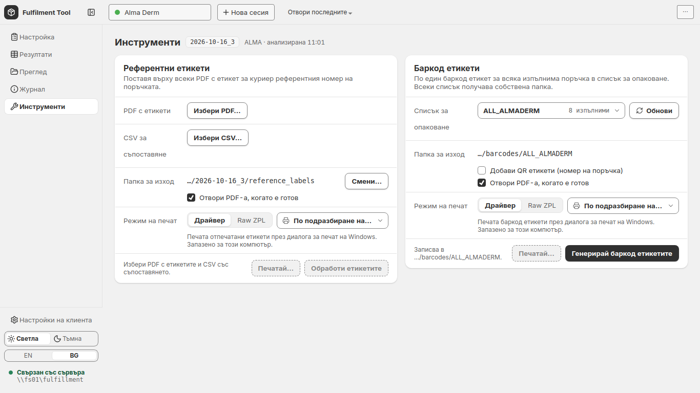

За да отпечатате номера за референция върху всеки куриерски етикет:

1. Натиснете **Избери PDF…** до **PDF с етикети** и изберете файла с куриерските етикети.
2. Натиснете **Избери CSV…** до **CSV за съпоставяне** и изберете файла за съпоставяне.
3. Проверете **Папка за изход**. За да запишете на друго място, натиснете **Смени…**.
4. Изберете **Драйвер** или **Raw ZPL** под **Режим на печат**, после изберете принтера. Изборът се запазва на този компютър.
5. Натиснете **Обработи етикетите**. Когато етикетите са готови, натиснете **Print…**.

За да направите баркод етикети за списък за опаковане:

1. Изберете списъка под **Списък за опаковане**. Ако списъкът липсва, натиснете **Обнови**.
2. Маркирайте **Добави QR етикети (номер на поръчка)**, ако ви трябват QR кодове.
3. Натиснете **Генерирай баркод етикетите**. Всеки списък получава своя папка, която показва **Папка за изход**.

### 10. Журнал

Натиснете **Журнал** в страничната лента. Журналът показва какво е направило приложението и всички проблеми, които е открило.

1. Изберете **Всички**, **Дейност** или **Изпълнение**, за да изберете източника.
2. Изберете **Инфо**, **Предупреждение** или **Грешка**, за да изберете нивото. Числата показват колко записа има всяко ниво.
3. За да намерите съобщение, въведете в **Търси в съобщенията и източниците**.
4. За да видите подробностите на грешка, натиснете ▸ на реда **Грешка**.
5. Маркирайте **Следвай най-новия запис**, за да държите последния ред видим. Маркирайте **Пренасяй дългите съобщения**, за да четете дълги редове.
6. За да запазите копие на журнала, натиснете **Запази като текст**.

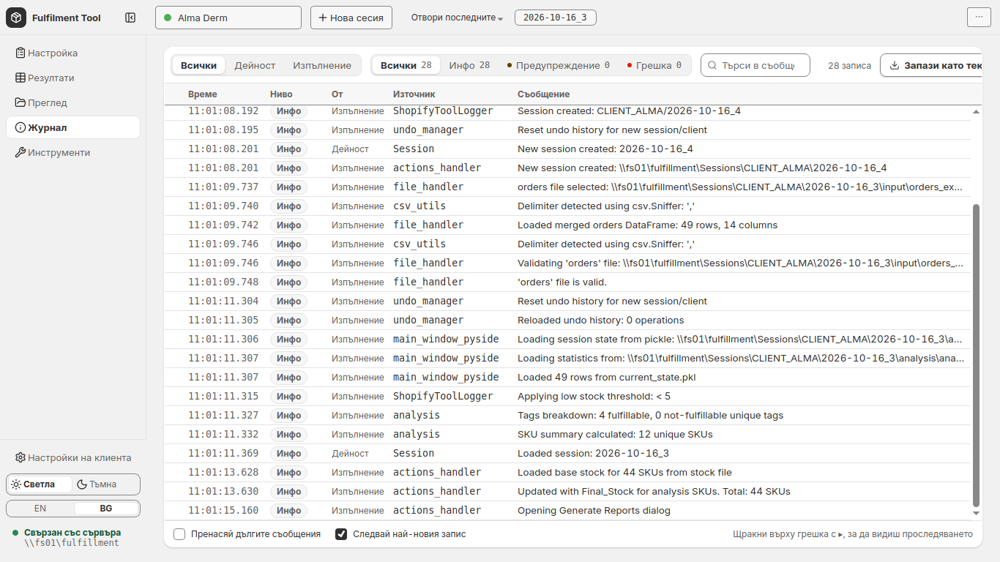

### 11. Когато нещо се обърка

Всяко съобщение по-долу е текстът, който показва приложението.

#### Този компютър не може да се свърже със сървъра за обработка на поръчки

Страницата Настройка показва **Този компютър не може да се свърже със сървъра за обработка на поръчки**. В страничната лента пише **Няма връзка със сървъра**. Заредените файлове остават заредени.

1. Натиснете **Опитай отново** в страничната лента.
2. Ако пак не успее, натиснете **Връзка със сървъра…** и проверете пътя до сървъра.
3. Ако пак не успее, попитайте човека, който се грижи за сървъра.

#### Друг компютър промени тази сесия

Приложението показва **Друг компютър промени тази сесия**. Някой на друг компютър е запазил сесията, след като сте я отворили. Приложението отказва да запази вашата промяна или да експортира. Отворете сесията отново, за да заредите техните промени.

1. Натиснете **Преглед**, после щракнете два пъти върху сесията, за да я отворите отново.
2. Направете промяната или експорта отново.

#### Артикулът го няма във файла с наличности

Когато добавяте артикул с **Добави артикул към поръчка**, приложението може да покаже съобщение като **SKU-123 го няма във файла с наличности. Натиснете „Добави въпреки това“, за да го добавите.** SKU-123 е въведеният от вас SKU.

1. Проверете SKU за грешки при писане.
2. Ако SKU е правилен, натиснете **Добави въпреки това**.

---

## Част 2 — Настройка

### Създаване на клиент

1. Отворете менюто с клиенти и натиснете **Нов клиент…**.
2. В **ID на клиента:** въведете ID на клиента. Използвайте само букви, цифри и долни черти. В **Име на клиента:** въведете името.
3. В **Копирай настройките от:** изберете **По подразбиране** или друг клиент.
4. Изберете **Група** и **Цвят:**, ако ви трябват. Маркирайте **Закачен:**, за да закачите клиента най-горе в страничната лента.
5. Натиснете **OK**. Новият клиент започва с настройките на Shopify по подразбиране. Можете да ги промените по-късно на страницата **Профил**.

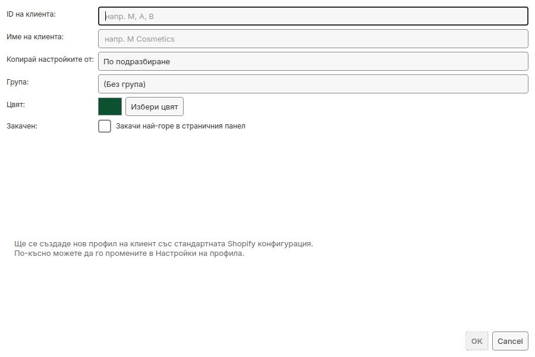

### Архивиране, възстановяване или изтриване на клиент

1. За да скриете клиент, отворете страницата му **Профил** в **Настройки на клиента** и натиснете **Архивирай клиента…**. Клиентът се скрива във Fulfilment и в Packing Tool. Сесиите му се запазват.
2. За да покажете отново архивиран клиент, отворете менюто с клиенти и натиснете **Архивирани клиенти…**. Изберете клиента и натиснете **Възстанови**.
3. **Изтрий клиента…** премахва клиента и папките му завинаги. Клиент, който има сесии, може само да бъде архивиран.

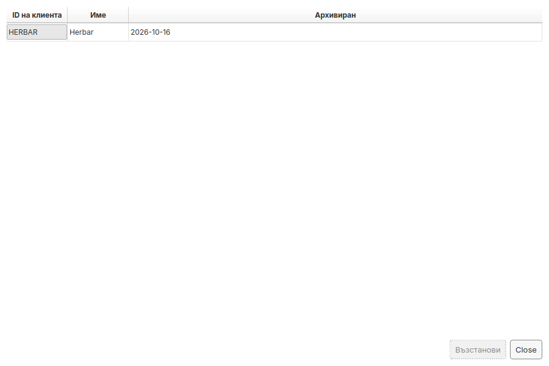

### Групи и закачане

1. За да създадете, преименувате или премахнете група, отворете менюто с клиенти и натиснете **Управление на групите…**. Използвайте **Създай група**, **Редактирай група** или **Изтрий група**.
2. За да поставите клиент в група, отворете страницата му **Профил** и изберете **Група**.
3. Закачен клиент е първи в менюто с клиенти, под **Закачени**.

### Настройки на клиента

Натиснете **Настройки на клиента** в долната част на страничната лента. Изберете страница вляво. Натиснете **Запази**, за да запазите промените. Натиснете **Отказ**, за да затворите прозореца без запис.

### Профил

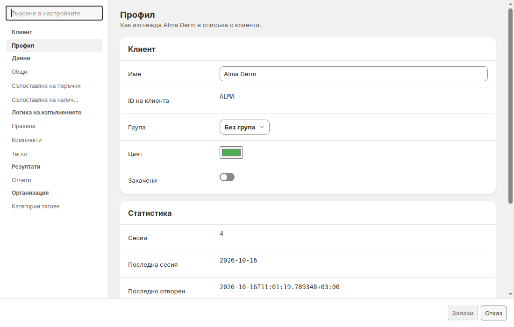

- Променете **Име** и **Група**. Включете **Закачен:**, за да закачите клиента най-горе в страничната лента.
- **Статистика** е само за четене. Показва **Сесии**, **Последна сесия** и **Последно отворен**.
- Страницата има и **Архивирай клиента…** и **Изтрий клиента…**. Вижте раздел „Архивиране, възстановяване или изтриване на клиент“.

### Общи

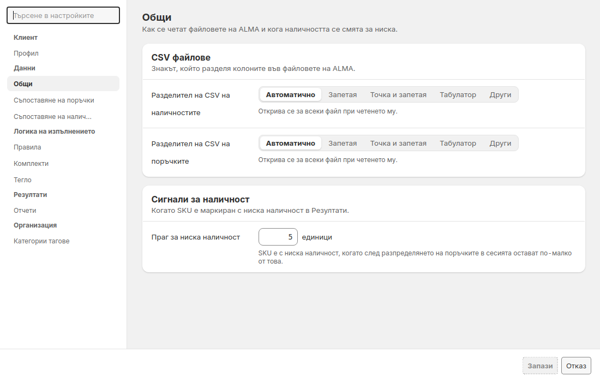

- За **Разделител на CSV на наличностите** и **Разделител на CSV на поръчките** оставете **Автоматично**. Приложението намира разделителя във всеки файл. Изберете **Запетая**, **Точка и запетая**, **Табулатор** или **Други**, само ако Автоматично сгреши.
- **Праг за ниска наличност** задава кога един SKU е с ниска наличност. SKU е с ниска наличност, когато след разпределението на поръчките остават по-малко от този брой. В **Резултати** го маркира с **Ниска наличност**.

### Съпоставяне на поръчки

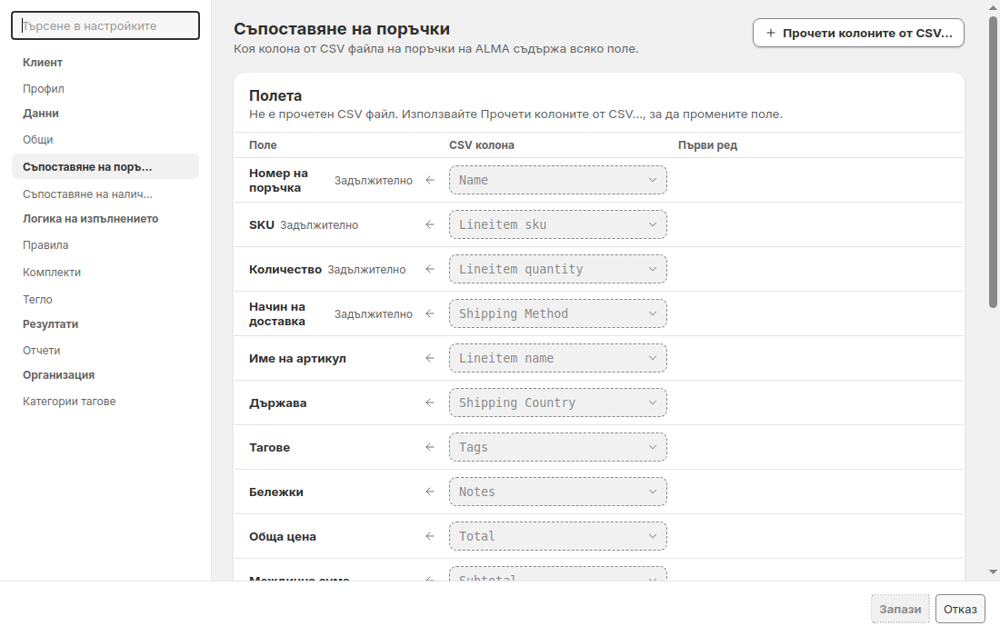

- Тази страница показва в коя колона на файла с поръчки е всяко поле.
- Натиснете **Прочети колоните от CSV…** и изберете примерен файл с поръчки. Списъците се попълват с неговите колони.
- Изберете колона за всяко поле. Полетата, означени с **Задължително**, трябва да бъдат зададени: **Номер на поръчка**, **SKU**, **Количество** и **Начин на доставка**.

### Съпоставяне на наличности

Страницата за съпоставяне на наличностите работи като **Съпоставяне на поръчки**, но за файла с наличности в склада. Натиснете **Прочети колоните от CSV…** и изберете колоната за всяко поле.

- **SKU** и **Количество** са задължителни.
- **Дата на годност** е по избор. Когато е зададена, първо се използват наличностите с най-ранна дата на годност, а всеки ред в списъка за опаковане показва тяхната партида. Приложението чете датите като YYMMDD, YYYYMMDD, DDMMYY или MMYY.
- **Партида** е по избор. Тя разделя отделните доставки на един SKU, а всеки списък за опаковане я показва.

### Правила

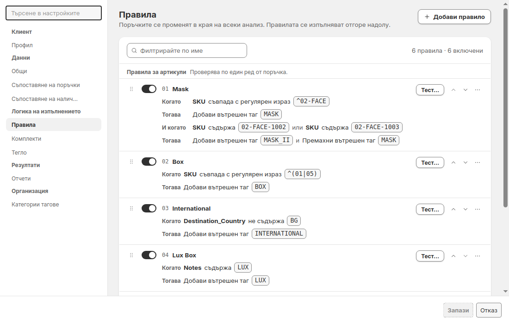

- Правилата променят поръчките в края на всеки анализ. Изпълняват се отгоре надолу.
- Натиснете **Добави правило**, за да създадете правило. Всяко правило има част **Когато** и част **Тогава**.
- Използвайте превключвателя на правило, за да го включите или изключите. Използвайте стрелките, за да го преместите нагоре или надолу.
- Натиснете **Тест…**, за да изпробвате правило върху последния анализ. Работи само след като е стартиран анализ и само за правило с поне едно условие.

### Комплекти

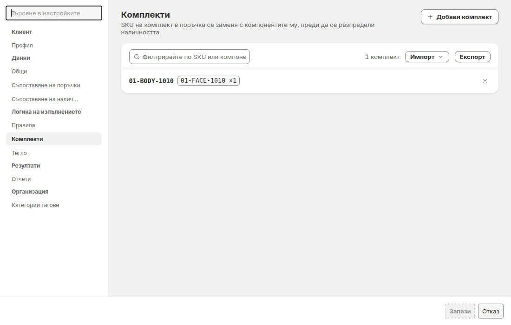

- SKU на комплект в поръчка се заменя с компонентите си, преди да се разпределят наличностите.
- Натиснете **Добави комплект**, за да създадете комплект. Използвайте **Импорт** или **Експорт**, за да прехвърлите комплекти навътре или навън.
- За да намерите комплект, въведете в **Филтрирайте по SKU или компонент**.

### Тегло

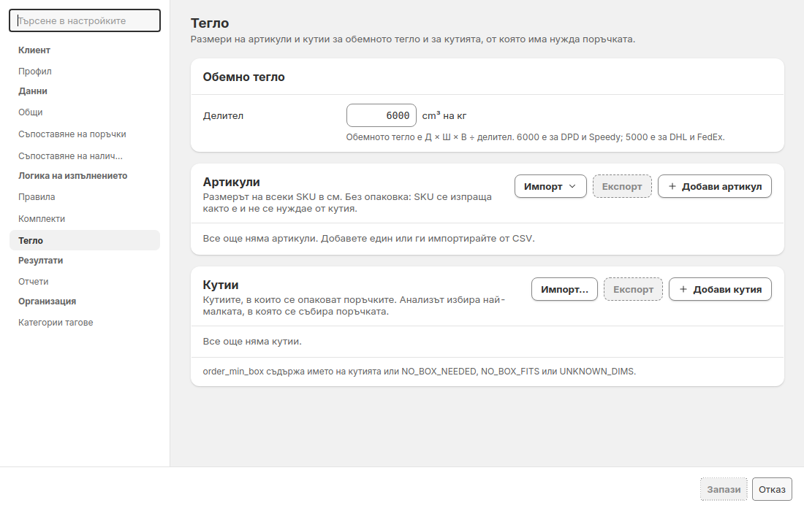

- **Делител** задава обемното тегло. Обемното тегло е дължина × ширина × височина ÷ делител. Използвайте 6000 за DPD и Speedy. Използвайте 5000 за DHL и FedEx.
- **Артикули** показва размера на всеки SKU в см. SKU без опаковка се изпраща такъв, какъвто е, и не се нуждае от кутия. Натиснете **Добави артикул** или използвайте **Импорт**, за да заредите CSV.
- **Кутии** показва кутиите, в които се опаковат поръчките. Анализът избира най-малката кутия, в която поръчката се побира. Натиснете **Добави кутия** или използвайте **Импорт…**, за да заредите CSV.

### Отчети

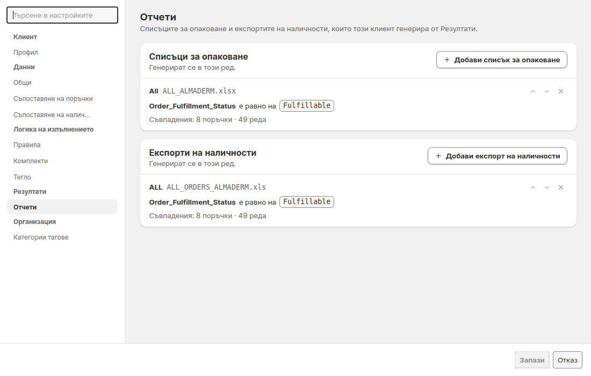

- Тази страница показва списъците за опаковане и експортите на наличности, които клиентът прави от **Резултати**. Вижте раздел 7.
- Натиснете **Добави списък за опаковане** или **Добави експорт на наличности**, за да добавите отчет.
- Всеки отчет има филтър. В отчета влизат само поръчките, които съвпадат с него.

### Категории на тагове

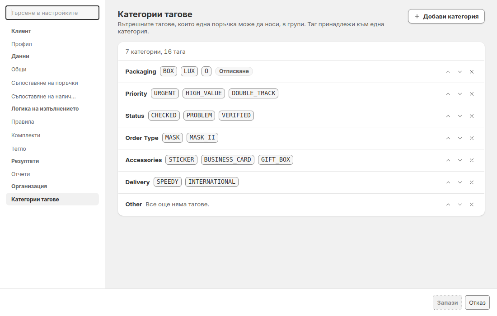

- Поръчката може да носи вътрешни тагове. Таговете са групирани в категории, а всеки таг принадлежи на една категория.
- Натиснете **Добави категория**, за да създадете нова категория.
- Категорията със значката **Отписване** е категорията за опаковки. Вижте **Отписване на опаковки** в раздел 7.

Помощ: натиснете ⋯ и после **Ръководство**, или натиснете **F1**, за да отворите това ръководство.
