# Fulfilment — User guide

## Part 1 — Daily work

### 1. What Fulfilment does

Fulfilment checks the day's Shopify orders against the warehouse stock. It shows which orders can ship complete. Then it makes the packing lists and stock exports for the client.

Packing Tool packs the packing lists that Fulfilment made. The steps are:

1. Get the Shopify orders export. It is a CSV file.
2. Get the warehouse stock export. It is a CSV file.
3. Load both files in Fulfilment and run the analysis.
4. Check the results and make the packing lists.
5. Packing Tool opens the packing lists.

### 2. Start the app

1. Open **Fulfilment Tool**.
2. Look at the bottom of the left sidebar. **Server connected** means this PC can reach the server. If it says **Server unreachable**, see section 11.
3. To change the language, click **EN** or **BG** at the bottom of the sidebar. To switch the theme, click **Light** or **Dark**.
4. Click ⋯ at the top right. The menu has **User guide**, **Server connection…**, **Check for updates…** and **Keyboard shortcuts…**.

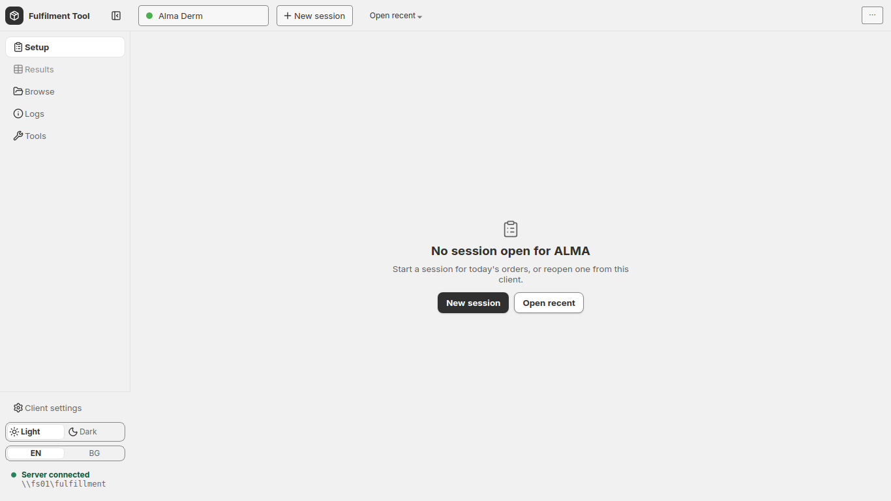

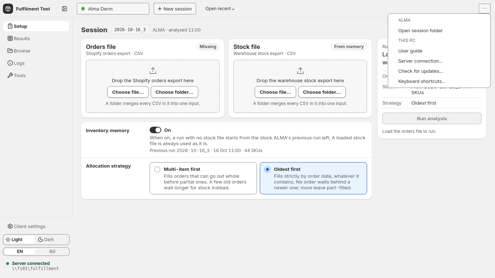

### 3. Choose a client

Each session, stock file and report belongs to one client.

1. Click the client name at the top left.
2. To find a client, type in **Filter clients**.
3. Click the client you need.

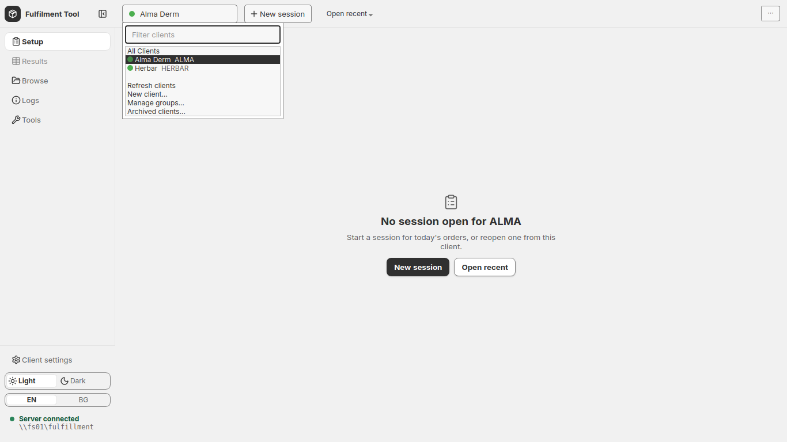

### 4. Start a session and load the files

A session holds one day's orders for one client.

1. Click **New session**. The new session has today's date in its name, for example `2026-10-16_4`.
2. In **Orders file**, drop the Shopify orders export on the box. You can also click **Choose file…**. To merge several CSV files into one input, click **Choose folder…**.
3. In **Stock file**, do the same with the warehouse stock export. Leave it empty if you want the stock from the last run. When **Inventory memory** is **On**, a run with no stock file starts from the stock the last run left. A stock file you load is always used as it is.
4. Choose **Allocation strategy**:
   - **Oldest first** fills strictly by order date. No order waits behind a newer one. More orders may be part-filled.
   - **Multi-item first** fills orders that can go out whole before partial ones. A few old orders may wait longer for stock.

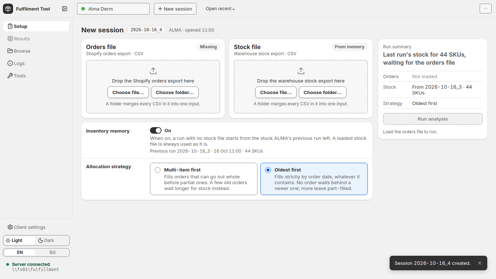

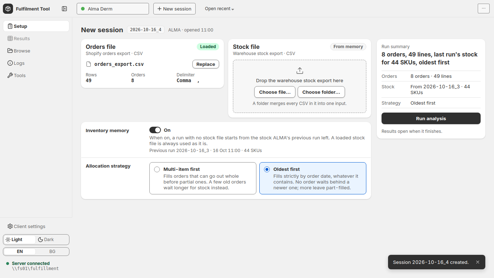

> **Tip:** **Run analysis** stays grey until the orders file is loaded.

### 5. Run the analysis

1. Check the **Run summary** card on the right. It shows the orders and lines, the stock used and the strategy.
2. Click **Run analysis**. You can also press **Ctrl+R**.
3. Wait. The Setup page shows the step the run is on. When the run finishes, the **Results** tab opens.

### 6. Read the results

Click **Results** in the sidebar. The table has one row for each order.

- **Fulfillable** means the whole order can ship. **Blocked** means at least one SKU line is short, so the whole order waits.
- The numbers at the top are **Orders**, **Fulfillable**, **Blocked**, **Labels** and **Value ready**. **Labels** is one courier label for each fulfillable order, split by courier.
- To find an order, type in the search box **Order, customer or SKU**.
- To narrow the list, click **Add filter**. You can filter by **Status**, by **Flags**, by **Courier** or by **Tags**. The flags are **Repeat**, **Unknown SKU**, **Low stock** and **3 or more lines**.
- To choose and order the columns, click **Columns**. **Status** and **Order** always stay first.
- Click a row. The **Order detail** pane on the right says whether the order can ship and, if it cannot, why.
- To hold a fulfillable order, click **Hold** in the detail pane. To mark a blocked order as fulfillable, click **Mark fulfillable**.
- Tick the boxes at the start of several rows to act on those orders together.
- To make packing lists and stock exports, click **Export**. See section 7.

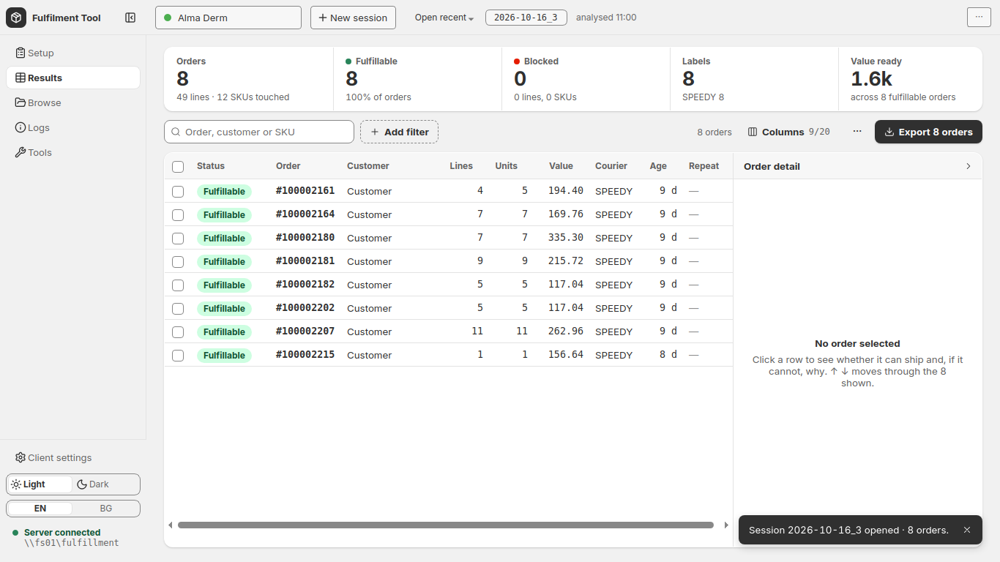

> **Note:** A repeat order is marked, but it is never held. It stays fulfillable.

> **Note:** The verdict in the detail pane says who set the status. It reads either **Detected by the run, not set by a person.** or **Set by a person, not detected by the run.**

To add a product to an order:

1. Click ⋯ at the top of the Results tab, then click **Add Product to Order**.
2. Type the order number in **Order Number:**.
3. Type the SKU in **Product SKU:**. Change **Quantity:** if you need more than one.
4. Click **Add Product**.

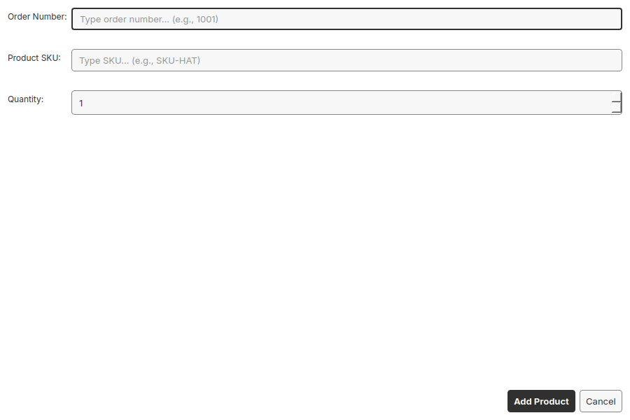

### 7. Make the packing lists and stock exports

1. On the **Results** tab, click **Export**. The **Generate Reports** window opens.
2. Tick each packing list under **PACKING LISTS**. Tick each stock export under **STOCK EXPORTS**. The preview shows how many orders and rows match.
3. Under **Packaging write-off**, choose one option: **Leave packaging materials out**, **Include them in the stock export** or **Write them to a file of their own**.
4. Click **Generate Selected Reports**.

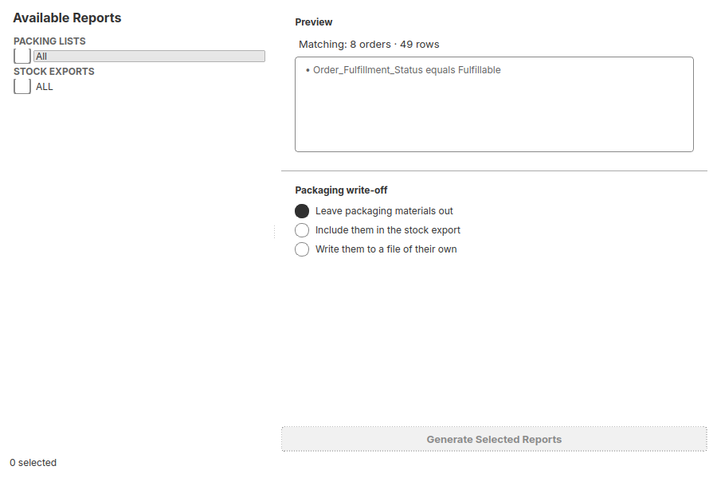

The packing lists are saved in the session's `packing_lists` folder. Stock exports are saved in its `stock_exports` folder. Packing Tool reads the packing lists from that folder.

> **Note:** If the orders change after a packing list is made, make the list again. The new list replaces the old one.

### 8. Open an earlier session in Browse

1. Click **Browse** in the sidebar.
2. Click a tab to filter the sessions: **All**, **Active**, **Completed**, **Abandoned** or **Archived**.
3. To find a session by its name or comment, type in **Search sessions**.
4. Double-click the session to open it.

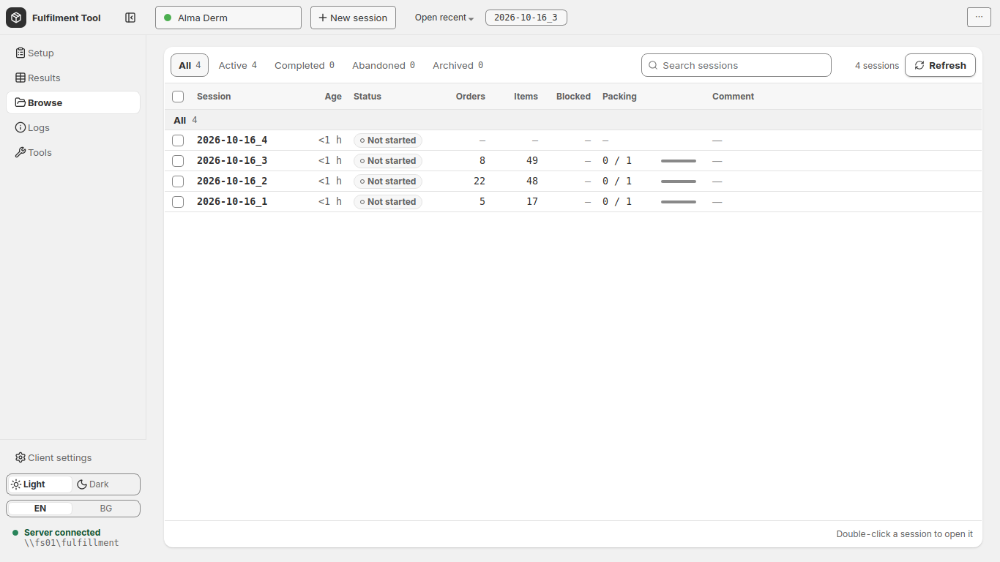

The **Status** column shows **Not started**, **In progress**, **Paused**, **Stale**, **Completed**, **Incomplete** or **Abandoned**. A session shows **Incomplete** when packing is not finished.

> **Note:** **Stale** means another PC saved this session after you loaded it. Reopen the session before you save or export.

### 9. Tools: reference labels and barcodes

Click **Tools** in the sidebar. The tools need an open session. They read the session's files and save into its folder.

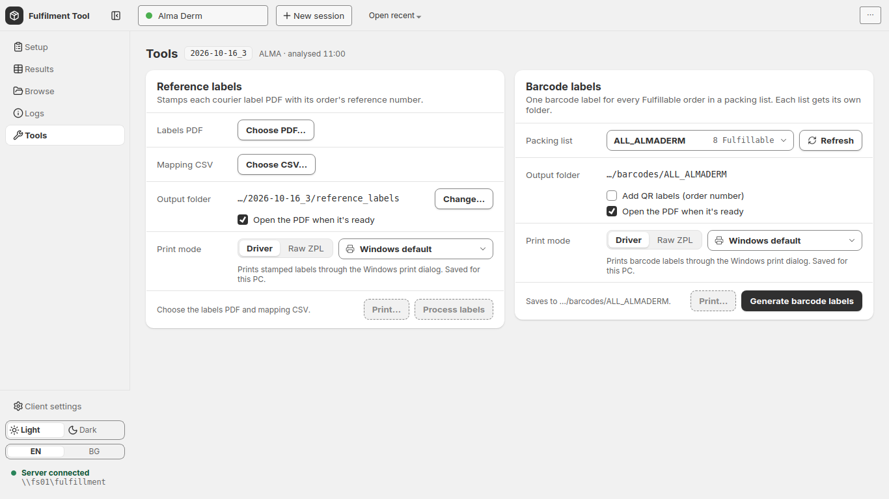

To stamp the reference number on each courier label:

1. Click **Choose PDF…** next to **Labels PDF** and pick the courier labels file.
2. Click **Choose CSV…** next to **Mapping CSV** and pick the mapping file.
3. Check **Output folder**. To save somewhere else, click **Change…**.
4. Choose **Driver** or **Raw ZPL** under **Print mode**, then pick the printer. The choice is saved on this PC.
5. Click **Process labels**. When the labels are ready, click **Print…**.

To make barcode labels for a packing list:

1. Choose the list under **Packing list**. If the list is missing, click **Refresh**.
2. Tick **Add QR labels (order number)** if you need QR codes.
3. Click **Generate barcode labels**. Each list gets its own folder, which **Output folder** shows.

### 10. Logs

Click **Logs** in the sidebar. The log lists what the app did and any problems it found.

1. Pick **All**, **Activity** or **Execution** to choose the source.
2. Pick **Info**, **Warning** or **Error** to choose the level. The numbers show how many entries each level has.
3. To find a message, type in **Search messages and sources**.
4. To see the details of an error, click ▸ on the **Error** row.
5. Tick **Follow the newest entry** to keep the latest line in view. Tick **Wrap long messages** to read long lines.
6. To keep a copy of the log, click **Save as text**.

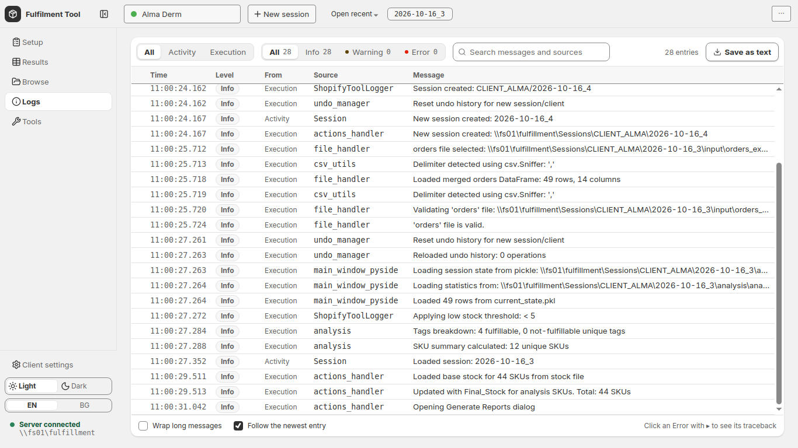

### 11. When something goes wrong

Each message below is the text the app shows.

#### This PC can't reach the fulfilment server

The Setup page says **This PC can't reach the fulfilment server**. The sidebar says **Server unreachable**. Your loaded files stay loaded.

1. Click **Retry** in the sidebar.
2. If it still fails, click **Server connection…** and check the server path.
3. If it still fails, ask the person who looks after the server.

#### Another PC changed this session

The app shows **Another PC changed this session**. Someone on another PC saved the session after you opened it. The app refuses to save your change or to export. Reopen the session to load their changes.

1. Click **Browse**, then double-click the session to open it again.
2. Make your change or export again.

#### A SKU isn't in the stock file

When you add a product with **Add Product to Order**, the app can show a message such as **SKU-123 isn't in the stock file. Press Add anyway to add it.** SKU-123 stands for the SKU you typed.

1. Check the SKU for typing mistakes.
2. If the SKU is right, click **Add anyway**.

---

## Part 2 — Setting up

### Create a client

1. Open the client menu and click **New client…**.
2. In **Client ID:**, type the client ID. Use letters, numbers and underscores only. In **Client Name:**, type the name.
3. In **Copy settings from:**, choose **Defaults** or another client.
4. Choose a **Group** and a **Color:** if you need them. Tick **Pinned:** to pin the client to the top of the sidebar.
5. Click **OK**. The new client starts with the default Shopify settings. You can change them later on the **Profile** page.

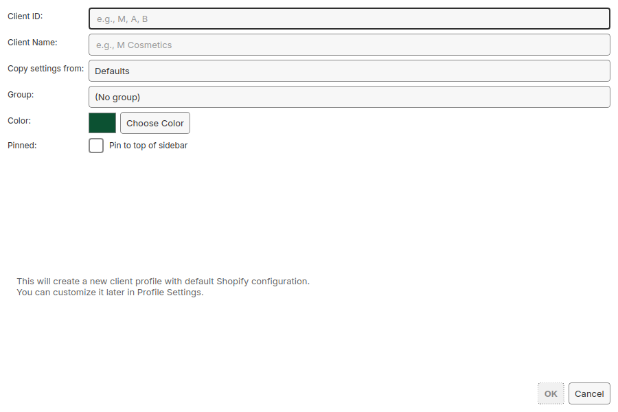

### Archive, restore or delete a client

1. To hide a client, open its **Profile** page in **Client settings** and click **Archive client…**. The client is hidden in Fulfilment and in Packing Tool. Its sessions are kept.
2. To show an archived client again, open the client menu and click **Archived clients…**. Select the client and click **Restore**.
3. **Delete client…** removes the client and its folders for good. A client that has sessions can only be archived.

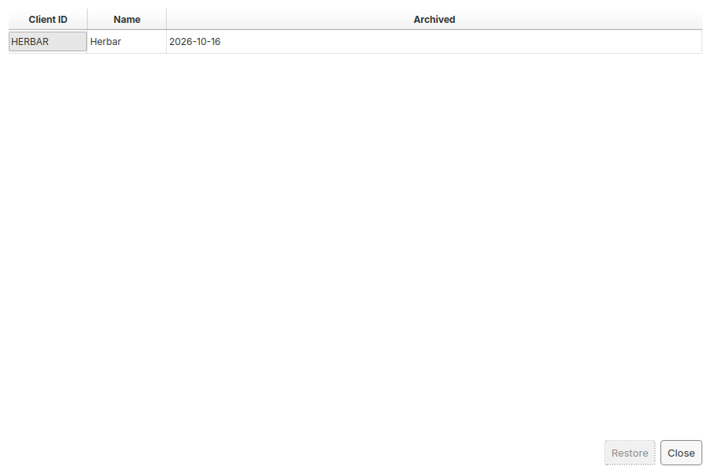

### Groups and pins

1. To make, rename or remove a group, open the client menu and click **Manage groups…**. Use **Create Group**, **Edit Group** or **Delete Group**.
2. To put a client in a group, open its **Profile** page and choose the **Group**.
3. A pinned client is listed first, under **Pinned**, in the client menu.

### Client settings

Click **Client settings** at the bottom of the sidebar. Choose a page on the left. Click **Save** to keep your changes. Click **Cancel** to close the window without saving.

### Profile

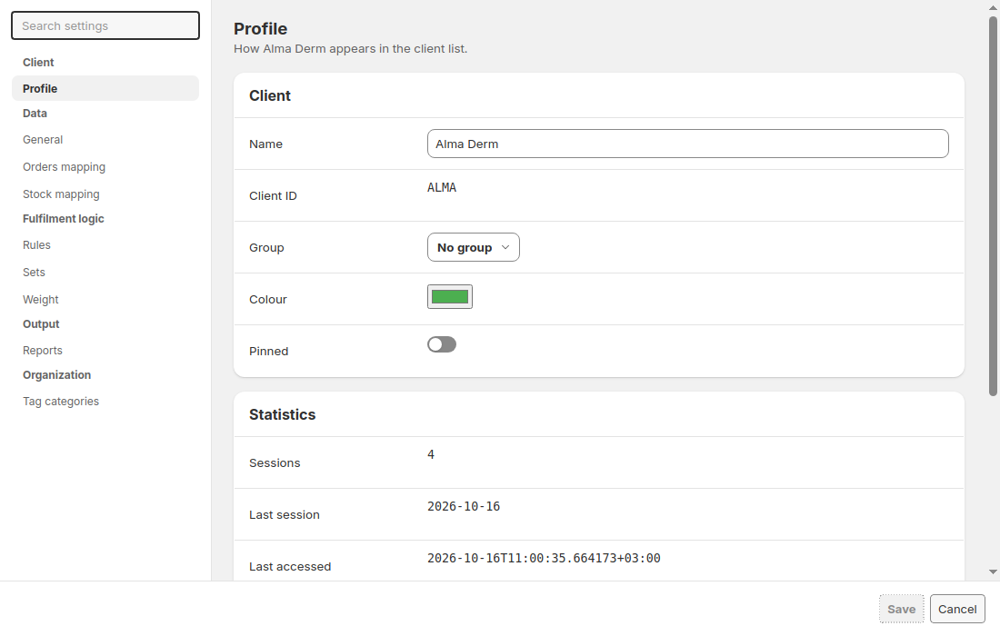

- Change the **Name** and the **Group**. Turn on **Pinned** to pin the client to the top of the sidebar.
- **Statistics** is read only. It shows **Sessions**, **Last session** and **Last accessed**.
- The page also has **Archive client…** and **Delete client…**. See section "Archive, restore or delete a client".

### General

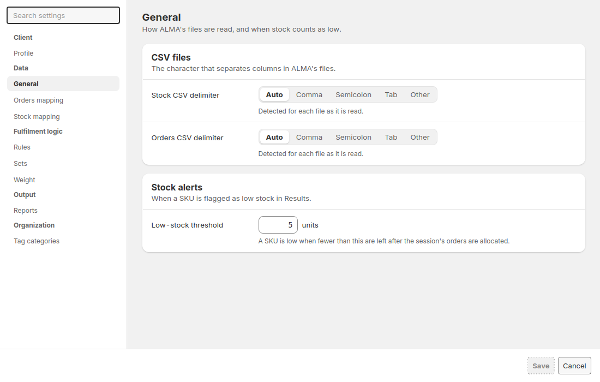

- For **Stock CSV delimiter** and **Orders CSV delimiter**, keep **Auto**. The app finds the separator in each file. Choose **Comma**, **Semicolon**, **Tab** or **Other** only if Auto gets it wrong.
- **Low-stock threshold** sets when a SKU counts as low. A SKU is low when fewer than this many are left after the orders are allocated. Results marks it **Low stock**.

### Orders mapping

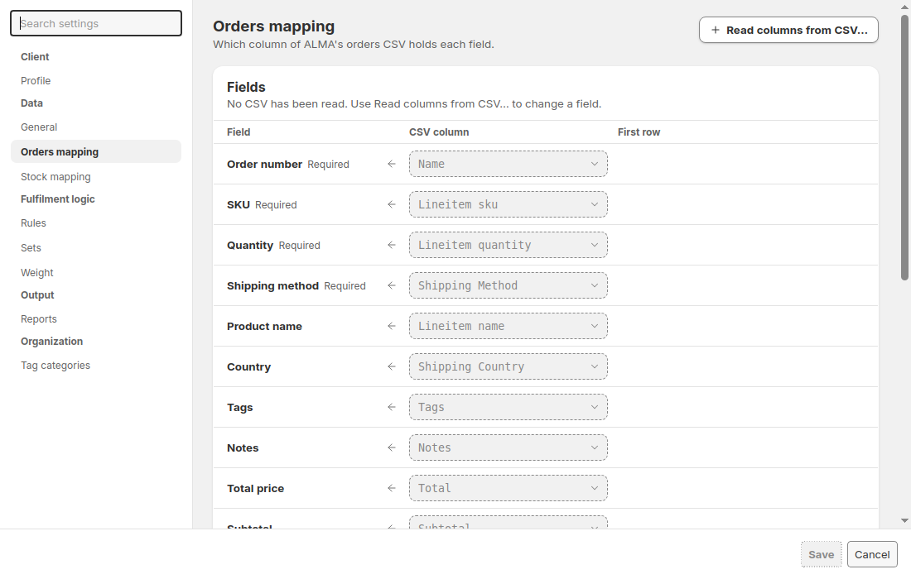

- This page says which column of the orders file holds each field.
- Click **Read columns from CSV…** and pick a sample orders file. The lists fill with its columns.
- Pick the column for each field. The fields marked **Required** must be set: **Order number**, **SKU**, **Quantity** and **Shipping method**.

### Stock mapping

The stock mapping page works like **Orders mapping**, for the warehouse stock file. Click **Read columns from CSV…** and pick the column for each field.

- **SKU** and **Quantity** are required.
- **Expiry date** is optional. When it is set, stock is used oldest expiry first, and each packing list row shows its lot. The app reads the dates as YYMMDD, YYYYMMDD, DDMMYY or MMYY.
- **Batch** is optional. It keeps separate deliveries of one SKU apart, and each packing list shows it.

### Rules

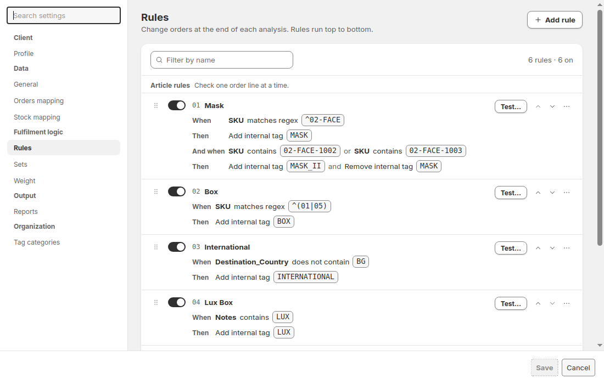

- Rules change orders at the end of each analysis. They run from top to bottom.
- Click **Add rule** to make a rule. Each rule has a **When** part and a **Then** part.
- Use the switch on a rule to turn it on or off. Use the arrows to move it up or down.
- Click **Test…** to try a rule on the last analysis. It works only after an analysis has run, and only for a rule with at least one condition.

### Sets

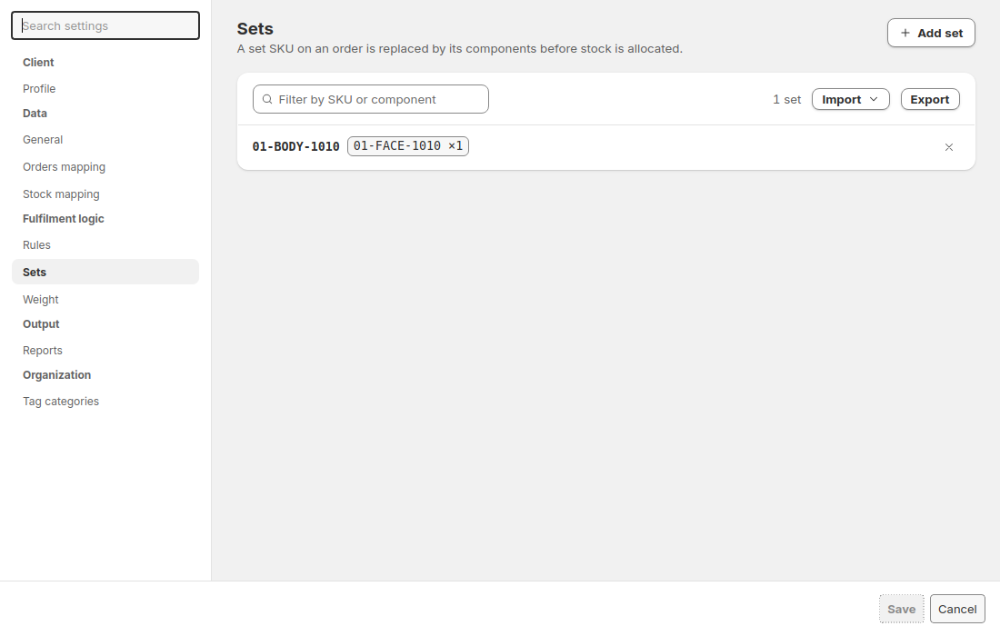

- A set SKU on an order is replaced by its components before stock is allocated.
- Click **Add set** to make a set. Use **Import** or **Export** to move sets in and out.
- To find a set, type in **Filter by SKU or component**.

### Weight

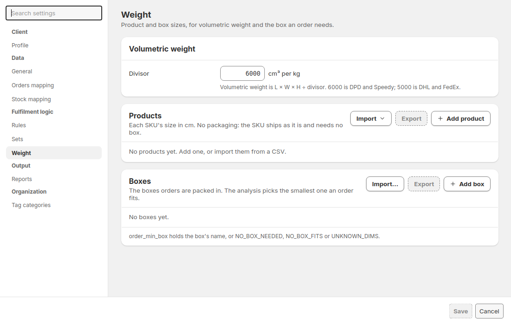

- **Divisor** sets the volumetric weight. The volumetric weight is length × width × height ÷ divisor. Use 6000 for DPD and Speedy. Use 5000 for DHL and FedEx.
- **Products** lists the size of each SKU in cm. A SKU with no packaging ships as it is and needs no box. Click **Add product**, or use **Import** to load a CSV.
- **Boxes** lists the boxes that orders are packed in. The analysis picks the smallest box an order fits. Click **Add box**, or use **Import…** to load a CSV.

### Reports

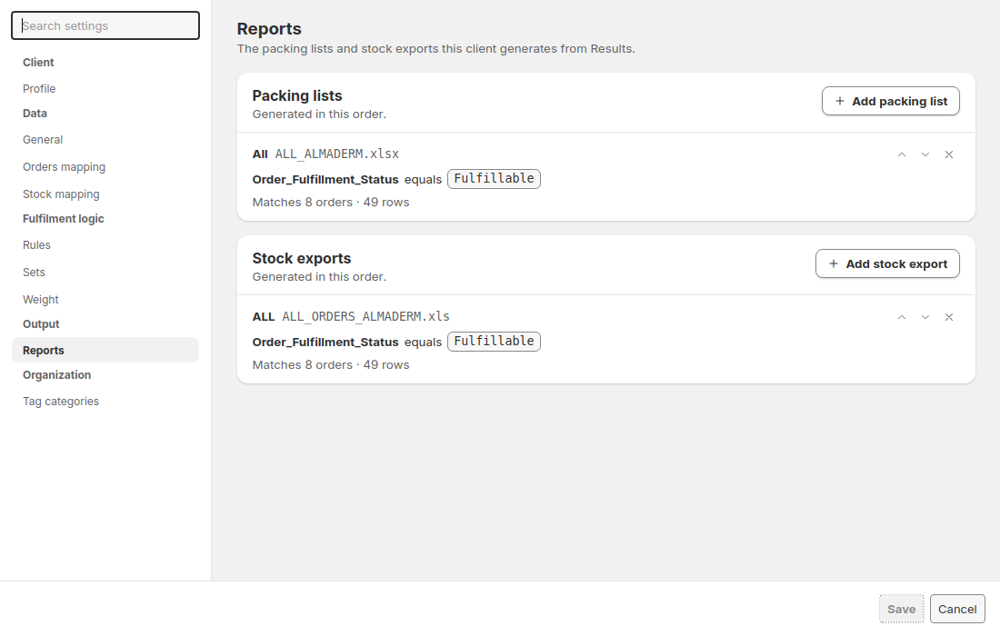

- This page lists the packing lists and stock exports that the client makes from **Results**. See section 7.
- Click **Add packing list** or **Add stock export** to add a report.
- Each report has a filter. Only the orders that match it go into the report.

### Tag categories

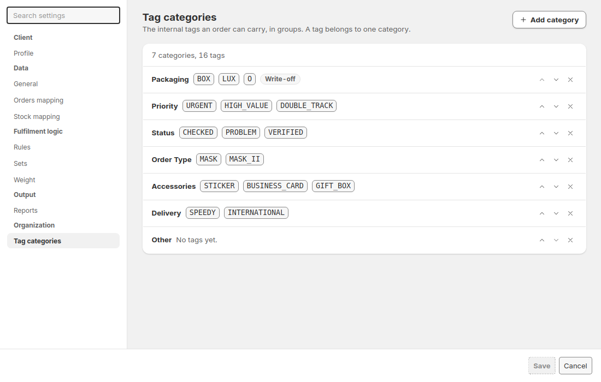

- An order can carry internal tags. Tags are grouped in categories, and each tag belongs to one category.
- Click **Add category** to make a new category.
- The category with the **Write-off** badge is the packaging category. See **Packaging write-off** in section 7.

Getting help: click ⋯ and then **User guide**, or press **F1**, to open this guide.
